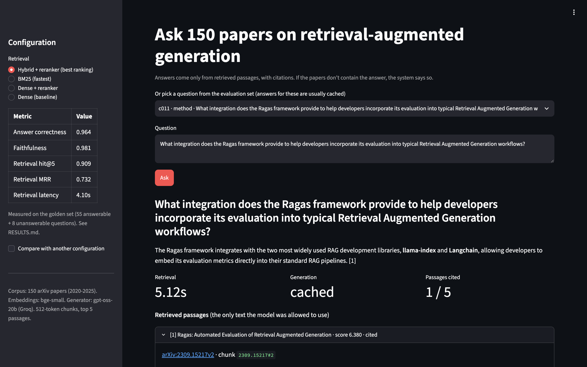
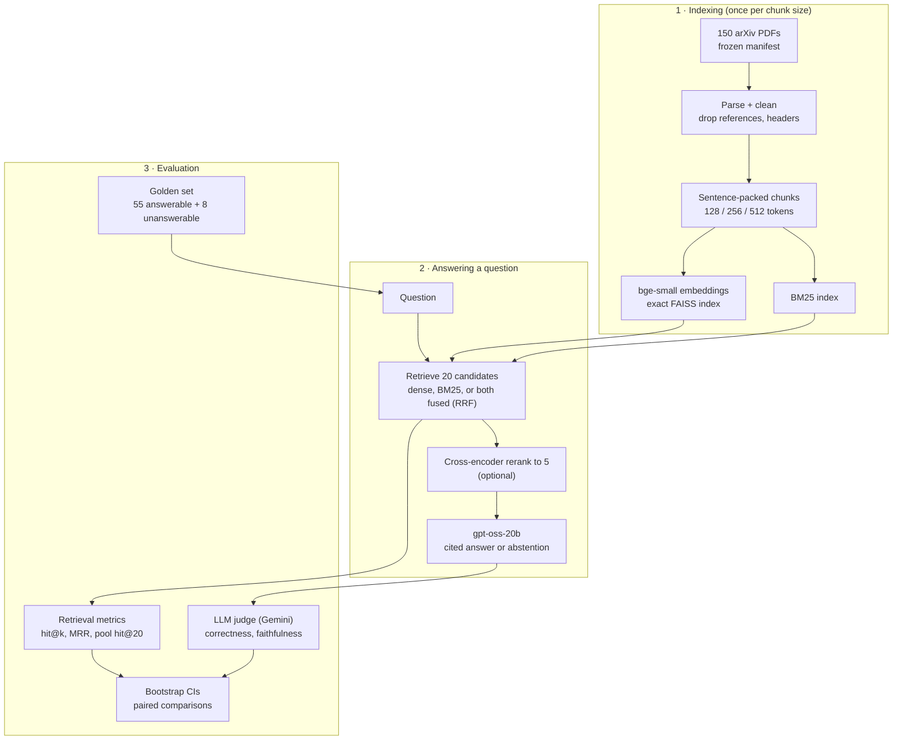
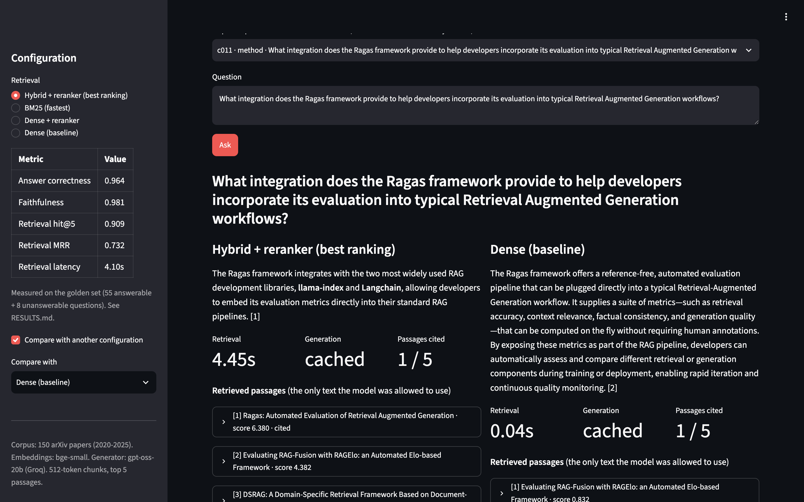

# RAG over ML papers, with an evaluation layer that proves what works

Question answering over a frozen corpus of **150 arXiv papers on retrieval-augmented generation**,
plus an evaluation harness that compares 15 retrieval configurations and shows, with confidence
intervals, which ones actually produce better answers.

**Result:** retrieval was the bottleneck. Hybrid search (BM25 + dense) with a cross-encoder reranker
raised answer correctness from **0.855 to 0.964**, and plain BM25 to **0.982**, both statistically
significant over the dense baseline and tied with each other. BM25 does it at ~4,000× lower latency.
Full write-up: **[RESULTS.md](RESULTS.md)**.

| Configuration (512-token chunks) | Answer correctness | Δ vs dense (paired 95% CI) | Retrieval MRR | Retrieval latency |
|---|---|---|---|---|
| Dense (baseline) | 0.855 | — | 0.527 | 0.05 s |
| **Hybrid + reranker** | **0.964** | **+0.109 [+0.027, +0.209]** | **0.732** | 4.1 s |
| **BM25** | **0.982** | **+0.127 [+0.036, +0.227]** | 0.690 | **0.001 s** |
| Dense + reranker | 0.927 | +0.073 [+0.000, +0.154] | 0.678 | 4.1 s |

All configurations declined 8/8 unanswerable questions. Built entirely on free tiers, on a 2-core CPU.



## What makes it interesting

- **Ground truth anchored to the paper text, not to chunks.** Each of the 63 golden questions stores its evidence quote plus character offsets, so the same set scores every chunk size. 8 questions are deliberately unanswerable, to measure whether the system says "I don't know."
- **Every stage is scored separately.** Retrieval (hit@k, MRR, candidate-pool recall) against the evidence offsets; answers (correctness, claim-level faithfulness, relevance) by an LLM judge from a different model family, spot-checked by hand.
- **Differences are tested, not eyeballed.** Bootstrap confidence intervals on every metric, paired bootstrap for comparisons, and a finalist rule fixed before the results were in.
- **A diagnosis, not just a leaderboard.** In the baseline, every question where retrieval found the evidence was answered correctly (38/38), so the experiments targeted retrieval.
- **Reproducible.** Frozen corpus with versioned IDs and checksums, pinned dependencies, and a disk cache of every LLM call. Re-running the baseline reproduces every number with zero API calls.

## Architecture



## Stack

| Layer | Choice | Why |
|---|---|---|
| Framework | LlamaIndex (components only) | Its stages map onto the experiment axes; the evaluation is custom so results don't depend on framework internals |
| Parsing | PyMuPDF + custom cleaning | Ligatures, hyphenation, headers, reference lists |
| Chunking | Custom sentence-packing chunker | Same overlap rule at every size, token budget counted with the embedder's own tokenizer |
| Embeddings | `BAAI/bge-small-en-v1.5` | Strong for 33M parameters; runs on CPU |
| Vector search | FAISS, exact inner product | No approximation noise in comparisons |
| Sparse / hybrid | `bm25s` + reciprocal rank fusion (k = 60) | Exact matching of rare technical terms |
| Reranker | `cross-encoder/ms-marco-MiniLM-L-6-v2` | Small enough for CPU |
| Generator | `openai/gpt-oss-20b` via Groq (free tier) | Fast, temperature 0, grounded prompt with citations |
| Judge | `gemini-3.5-flash-lite` (free tier) | Different family from the generator, to avoid self-preference bias |
| Demo | Streamlit | Same pipeline object the evaluation measured |

## Quickstart

Requirements: Python 3.10+, about 3 GB of disk, free API keys for [Groq](https://console.groq.com)
and [Google AI Studio](https://aistudio.google.com). GitHub Codespaces works well.

```bash
git clone https://github.com/rohithram22/rag-eval-arxiv.git && cd rag-eval-arxiv
bash scripts/setup.sh                 # venv + CPU-only PyTorch + pinned dependencies
source .venv/bin/activate
export GROQ_API_KEY=... GOOGLE_API_KEY=...   # or put them in .env (see .env.example)
python scripts/check_env.py           # packages, keys, model round-trips

python scripts/download_corpus.py     # the same 150 papers, checksums verified (~15 min)
python scripts/parse_corpus.py        # clean text -> data/processed/papers.jsonl
python scripts/build_index.py         # 512-token index (CPU: ~25 min)

python scripts/ask.py "How does DPR train its question and passage encoders?"
streamlit run app/app.py              # the demo
```

## Reproducing the experiments

```bash
python scripts/build_index.py --chunk-size 256 && python scripts/build_index.py --chunk-size 128
python scripts/evaluate.py                                   # baseline, end to end
python scripts/run_experiments.py --stage screen             # 15 configs, retrieval metrics only (free)
python scripts/compare.py                                    # leaderboard, one-factor effects, finalists
python scripts/run_experiments.py --stage full --labels c512-hybrid-rerank c512-bm25 c512-dense-rerank
python scripts/compare.py                                    # end-to-end comparison -> results/comparison.md
```

Each full run at 512-token chunks uses about 200,000 generator tokens, Groq's free daily limit for
`gpt-oss-20b`. If a run stops on the limit, run the same command later: finished answers are cached.

Useful tools: `scripts/inspect_run.py <config>` (failure cases by type), `scripts/show_chunks.py <question id>`
(the full retrieved chunks), `scripts/audit_judge.py <config>` (spot-check the judge).

## Demo

`streamlit run app/app.py` opens a page where you can ask a question or pick one from the golden set,
choose a retrieval configuration (its measured scores appear in the sidebar), and see the cited answer
with the passages it came from. Compare mode runs two configurations side by side.



The demo is meant to run locally rather than be deployed publicly: it displays paper text, which many
arXiv licenses don't allow redistributing, and it uses your own API quota.

## Project structure

```
configs/base.yaml        every setting; an experiment = this file + a few overrides
scripts/                 download, parse, index, golden set, evaluate, experiments, compare
src/rag_eval/            library: parsing, chunking, indexing, retrieval, prompts, pipeline,
                         golden set, metrics, judge, statistics, cached LLM calls
eval/                    golden set + its review history + judge audit (committed)
results/                 per-question results and summaries for every configuration (committed)
app/app.py               Streamlit demo
data/, indexes/, .cache/ PDFs, parsed text, indexes, LLM cache (gitignored, rebuilt by the scripts)
```

## Lessons from building it

- **Silent bugs only show up in metrics.** LlamaIndex's sentence splitter carries overlap only in whole sentences that fit the overlap budget, so at 128-token chunks only 32% of consecutive chunks overlapped (vs. 91% at 512). That would have confounded the chunk-size experiment. A custom chunker with one overlap rule fixed it.
- **Count tokens the way the model does.** Budgeting with a different tokenizer, or forgetting the model's special tokens, silently truncates chunks.
- **Check the property, not a proxy.** Reference-list removal failed twice on structural assumptions (position in the paper, one entry per text block) before a citation-density check worked on 145/150 papers.
- **LLM-written test data needs verification.** 15% of "verbatim" evidence quotes from the question generator weren't in the source passage.

## Limitations

55 answerable questions limit what can be detected (no significant chunk-size effect); questions name
their method, which likely favors BM25; ground truth has one evidence passage per question; the judge
was spot-checked on 10 answers. Details and future work are in [RESULTS.md](RESULTS.md#limitations).

## License and data

Code: MIT. The papers are not redistributed: `data/manifest.jsonl` lists the exact arXiv versions and
checksums, and `scripts/download_corpus.py` fetches them from arXiv.